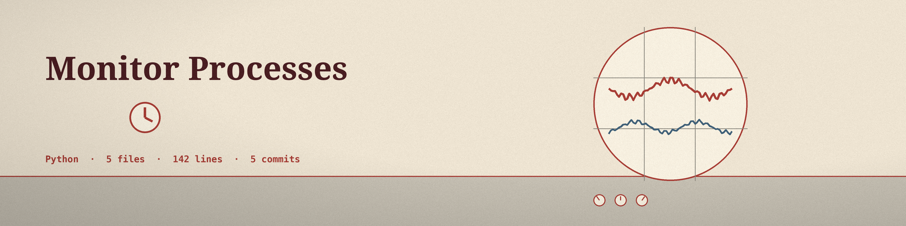

# monitor-processes
Monitor system processes for suspicious activity - Focused on System monitoring and alerts

## Install
`git clone https://github.com/ShadowStrikeHQ/monitor-processes`

## Usage
`python main.py [params]`

The first CPU reading for a newly seen process only primes its measurement, so a process can alert on CPU only from the second cycle in which it is observed; memory alerting has no such limit. A process that stays over a threshold is warned about once, and again only after it has dropped below that threshold and crossed it again. Processes that vanish are skipped silently, and access denied readings are logged at debug level only.

## Parameters
- `-h`: Show help message and exit
- `--interval`: Interval in seconds to check processes.
- `--cpu_threshold`: CPU usage threshold percentage.
- `--mem_threshold`: Memory usage threshold percentage.
- `--process_name`: Monitor only specified process by name.
- `--log_file`: Path to the log file.

## License
Copyright (c) ShadowStrikeHQ
